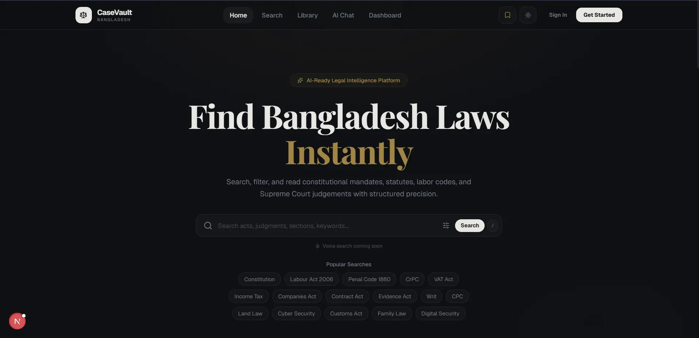
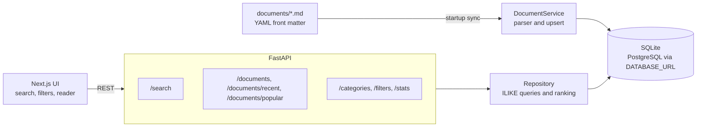

<div align="center">
  

  <p><code>Keyword search and a document reader for Bangladeshi statutes, constitutional articles and court judgements</code></p>

  <p>
    <a href="https://casevault-bd.vercel.app"></a>
    <a href="https://casevault-bd-api.vercel.app/docs"></a>
    <a href="https://github.com/Saji-d/casevault"></a>
    
  </p>

  <p>
    
    
    
    
    
    
    
    
  </p>

  <p>
    <a href="#-overview">Overview</a> · <a href="#-highlights">Highlights</a> · <a href="#-preview">Preview</a> · <a href="#-architecture">Architecture</a> · <a href="#-tech-stack">Tech Stack</a> · <a href="#-getting-started">Getting Started</a> · <a href="#-roadmap">Roadmap</a>
  </p>
</div>


## ◈ Overview

CaseVault is a legal document search app for Bangladeshi law. A FastAPI backend serves a small corpus of statutes, constitutional articles and judgements, and a Next.js frontend lets you search, filter and read them.

- **What works today:** keyword search with filters, sorting and pagination, plus a document reader.
- **Honest scope:** this is a **Phase 1 prototype**. Development is paused and may resume. The AI summary, chat and citation layer shown on some pages are **placeholders for Phase 2** and are not implemented.
- **Corpus:** 46 Markdown documents written as seed content. There is no upload or OCR pipeline.


## ◈ Highlights

<table>
<tr>
<td width="33%" valign="top"><b>Ranked keyword search</b><br>Case-insensitive search over title, summary, content, category, slug and tags. Title matches rank first.</td>
<td width="33%" valign="top"><b>Rich filters</b><br>Filter by category, year, act number, language, status and tag, with sorting and pagination.</td>
<td width="33%" valign="top"><b>Document reader</b><br>Read each statute or judgement rendered from Markdown with its metadata.</td>
</tr>
<tr>
<td valign="top"><b>Markdown corpus</b><br>46 documents with YAML front matter across acts, constitution, civil, criminal, labour, tax and judgements.</td>
<td valign="top"><b>Sync on startup</b><br>The API parses the Markdown files and upserts them into the database by slug.</td>
<td valign="top"><b>Typed REST API</b><br>FastAPI with Pydantic schemas and interactive docs at <code>/docs</code>.</td>
</tr>
</table>

<details>
<summary><b>Corpus breakdown</b></summary>

| Folder | Documents |
| :--- | :--- |
| `acts` | 6 |
| `civil` | 6 |
| `constitution` | 5 |
| `criminal` | 6 |
| `labour` | 6 |
| `tax` | 6 |
| `judgements` | 11 |

</details>


## ◈ Preview

<div align="center">
  
</div>


## ◈ Architecture



- **Search endpoint:** `GET /search` accepts `keyword`, `title`, `category`, `year`, `act_number`, `language`, `status`, `tag`, `sort_by` (relevance, newest, oldest, alphabetical), `page` and `limit`.
- **Other endpoints:** `GET /documents`, `/documents/recent`, `/documents/popular`, `/documents/{slug}`, `/categories`, `/filters`, `/stats` and `POST /documents/sync`.
- **Placeholder pages:** `/chat`, `/dashboard`, `/workspace`, `/library` and `/admin` are labelled as prepared for Phase 2. The target design lives in [`Plan.md`](Plan.md).


## ◈ Tech Stack

| Layer | Technologies | Purpose |
| :--- | :--- | :--- |
| Backend | Python, FastAPI, SQLAlchemy, Pydantic | REST API, queries and validation |
| Database | SQLite (PostgreSQL via `DATABASE_URL`) | Document store rebuilt from Markdown |
| Frontend | Next.js 16, React 19, TypeScript | Search UI and document reader |
| Styling | Tailwind CSS 4, Framer Motion, lucide-react | Layout and animation |
| Deployment | Vercel | Frontend and API as separate projects |


## ◈ Getting Started

**Prerequisites:** Python 3 and Node.js.

Backend:

```bash
cd backend
python -m venv venv
venv\Scripts\activate          # macOS or Linux: source venv/bin/activate
pip install -r requirements.txt
python main.py                 # http://localhost:8000, docs at /docs
```

Frontend:

```bash
cd frontend
npm install
npm run dev                    # http://localhost:3000
```

The frontend calls `http://localhost:8000` by default.

| Variable | Default | Purpose |
| :--- | :--- | :--- |
| `DATABASE_URL` | `sqlite:///./casevault.db` | Database connection string |
| `DOCUMENTS_DIR` | `documents/` in the repo | Folder of Markdown documents to sync |
| `ALLOWED_ORIGINS` | localhost:3000 | JSON list of origins allowed by CORS |
| `NEXT_PUBLIC_API_URL` | `http://localhost:8000` | API base URL used by the frontend |

On Vercel the API uses a SQLite database in `/tmp` that is rebuilt from `documents/` on each cold start.


## ◈ Project Structure

<details>
<summary><b>Show the tree</b></summary>

```text
casevault/
├── backend/            # FastAPI app (routers, services, repositories, models)
├── documents/          # Markdown legal corpus with YAML front matter
├── frontend/           # Next.js app
├── api/index.py        # Vercel serverless entry point for the API
├── generate_docs.py    # Script used to author the seed documents
└── Plan.md             # Target architecture (not yet implemented)
```

</details>


## ◈ Roadmap

- [x] Markdown corpus with startup sync
- [x] Keyword search, filters, sorting and pagination
- [x] Document reader UI
- [ ] Semantic search with embeddings and a knowledge graph layer
- [ ] LLM-powered summary and citation layer
- [ ] OCR and document upload pipeline
- [ ] Authentication and firm workspaces


## ◈ Author

**Sajidur Rahman Sajid**, Full-Stack Developer and AI engineer from Dhaka.

[Portfolio](https://www.sajidur.me) · [LinkedIn](https://www.linkedin.com/in/sajidur-rahman-sajid/) · [GitHub](https://github.com/Saji-d) · [Email](mailto:sajidsajidurrahman99@gmail.com)

<div align="center"><sub>Legal text in the corpus is sample content for demonstration and is not legal advice.</sub></div>
